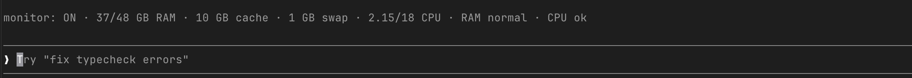
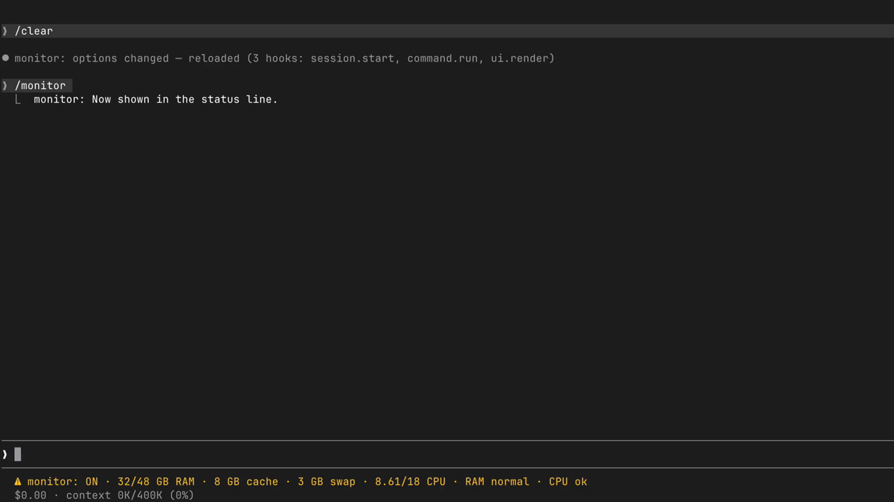
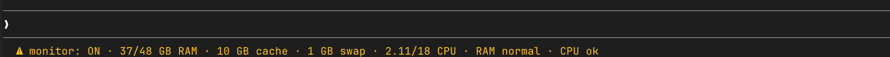

# claude-monitor

[](https://github.com/rolfhelder/claude-monitor/actions/workflows/ci.yml)
[](https://github.com/rolfhelder/claude-monitor/releases)
[](LICENSE)


Records RAM and CPU usage on your Mac and shows a live summary inside Claude Code, with local logs to look back at after a memory spike.



**macOS only.** On other systems `/monitor` says so and does nothing.

## Video tutorial

[](assets/monitor-tutorial.mp4)

57 seconds: the live line as RAM and CPU climb, `view` to move it into the status line and back, and `report 30m`. Click the image to open the video.

## Install

Inside Claude Code:

```
/plugin marketplace add rolfhelder/claude-plugins
/plugin install monitor@rolfhelder
```

Or from this repository alone:

```
/plugin marketplace add rolfhelder/claude-monitor
/plugin install monitor@claude-monitor
```

From a shell, the same works with `claude plugin marketplace add …` and `claude plugin install …`.

**Updates:** third-party marketplaces don't auto-update by default. Turn it on in `/plugin` → Marketplaces, or run `/plugin marketplace update`.

Then run `/monitor` to start recording.

## How it works

`/monitor on` installs a per-user launchd agent that runs a small Python sampler every few seconds. The plugin reads the newest sample and draws a line like:

```
monitor: ON · 30/48 GB RAM · 9 GB cache · 1 GB swap · 1.62/18 CPU · RAM normal · CPU ok
```

- **RAM** is used out of total, computed the way Activity Monitor computes "Memory Used"; **cache** is cached files.
- **CPU** is busy cores out of total since the previous sample.
- **RAM state** is macOS memory pressure (normal, warn, critical); **CPU state** is ok, busy or saturated.
- The line shows `stale` when the newest sample is older than three intervals.

The sampler (`sampler/sampler.py`, standard library only) reads kernel counters directly and runs one `ps` per sample; a sample takes a few tens of milliseconds.

## Commands

| Command | What it does |
| --- | --- |
| `/monitor` | Toggle the recorder on or off |
| `/monitor on` | Install the launchd agent (`~/Library/LaunchAgents/io.github.rolfhelder.claude-monitor.plist`) and start sampling |
| `/monitor off` | Stop the agent and remove its plist; logs are kept |
| `/monitor view` | Move the line between the row above the prompt and the status line |
| `/monitor report [30m\|2h\|3d]` | Summarise the window (default 2h): the worst moment (most swap + compressed memory), the apps and processes using the most memory and CPU then, and a timeline of pressure or swap-jump alerts |

Anything else after `/monitor` is handed to Claude with the command's help, so plain requests work too.

## Configuration

Set these in `/plugin configure monitor@rolfhelder` (or `@claude-monitor`) or in `/config`.

| Setting | Default | Meaning |
| --- | --- | --- |
| `sampleSeconds` | 5 | Sample interval, 2 to 300 seconds. |
| `placement` | `above-prompt` | `above-prompt`: a fixed row above the input. `status-line`: an entry in the status line, which can swap places with other plugins' entries. `/monitor view` toggles it. |
| `detailedLogs` | false | Also log full executable paths of top processes and, when cmux is installed, their cmux workspace name. To find it, the sampler reads process environments (`ps -axeww`) for the workspace id; only the workspace name is stored. |
| `hungApps` | false | Under memory pressure, ask System Events (at most once a minute) which apps don't respond. Needs Automation permission; apps it can't query are logged as `unknown`, not hung. |

Changing a setting rewrites and reloads the agent once; sessions don't touch launchd otherwise.



## Privacy: what is logged, and where

One JSON line per sample in `~/Library/Logs/claude-monitor/YYYY-MM-DD.jsonl`, the newest sample in `latest.json`. Files older than 14 days are deleted.

- System: RAM used and cached, free, wired, compressed, swap, memory pressure, load, busy CPUs.
- Per-app totals (memory, CPU, process count), grouped by app bundle or executable name.
- Top processes by memory and CPU: pid, memory, CPU and executable name.

No command-line arguments, environment values or session contents are recorded. With `detailedLogs` on, full executable paths and cmux workspace names are added.

**Logs never leave your Mac.** The plugin makes no network requests.

## Troubleshooting

- **The line says `stale`:** the sampler stopped writing. Look at `~/Library/Logs/claude-monitor/sampler.err`, then run `/monitor off` and `/monitor on`.
- **`/monitor on` refuses with a Python message:** install the Xcode command line tools (`xcode-select --install`) or put a working `python3` on your PATH. The plugin prefers `/usr/bin/python3` and checks that it runs before installing.
- **The line is missing:** run `/reload-plugins`; check `/plugin` shows monitor enabled.
- **Numbers differ from Activity Monitor:** Activity Monitor refreshes every 5 s by default (View → Update Frequency); match it with `sampleSeconds`.

## Uninstall

Run `/monitor off` first, then `/plugin uninstall monitor@rolfhelder` (or `@claude-monitor`). If the plugin is already gone:

```
launchctl bootout gui/$(id -u)/io.github.rolfhelder.claude-monitor
rm ~/Library/LaunchAgents/io.github.rolfhelder.claude-monitor.plist
rm -rf ~/Library/"Application Support"/claude-monitor ~/Library/Logs/claude-monitor
```

`/monitor on` copies the sampler to `~/Library/Application Support/claude-monitor/` so plugin updates don't break the agent. If no session has used the plugin for 30 days (for example, it was uninstalled without `/monitor off`), the agent removes itself.

## Development

```
claude plugin validate .
claude plugin test .
python3 -I sampler/test_sampler.py
```

Type-checking with `tsc` needs the type stubs Claude Code generates in `.claude-plugin/types/` (git-ignored) when it loads the plugin.

## Contributing and security

Bug reports, ideas and pull requests: see [CONTRIBUTING.md](CONTRIBUTING.md). Security issues: see [SECURITY.md](SECURITY.md). Changes are listed in [CHANGELOG.md](CHANGELOG.md).

## License

[MIT](LICENSE)
